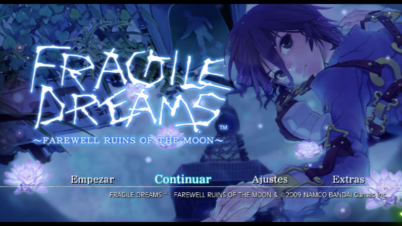

<h2 style="text-align: center;"><strong><a href="/fragile-dreams-farewell-ruins-of-the-moon/informacion/">INFORMACIÓN</a> - <a href="/fragile-dreams-farewell-ruins-of-the-moon/descargar/">DESCARGAS</a> - <a href="/fragile-dreams-farewell-ruins-of-the-moon/capturas/">CAPTURAS</a></strong></h2>

Proyecto llevado a cabo en Traducciones de Tío Víctor, por el siguiente equipo de personas: 
**CUE, Klint y Pacochan de Tales Translations, xulikotony, TheKiller**, y yo, **IlDucci**; 
con la colaboración de **yS, Raizing, Luffy, Ayato** y los creadores de **Riivolution**.

**Esta traducción no está relacionada de ninguna manera con BlogOcio Media, S.L. ni con su 
proyecto de fantraducción.**

El parche contiene todos los textos que había en inglés completamente traducidos al Castellano, 
y trae un pequeño extra: En los mapas había algunas líneas en Japonés que no se habían traducido 
en la versión oficial en inglés, y que con la ayuda de ys, Raizing, Luffy y Ayato, han sido 
traducidos íntegramente al Castellano.

Este parche utiliza el formato del sistema de parcheo al vuelo Riivolution, que permite a los 
usuarios que tengan una copia original del juego poder jugarlo traducido sin tener que realizar 
copia alguna de él.

Podéis bajaros el parcheador y saber más sobre este sistema en [https://wiibrew.org/wiki/Riivolution](WiiBrew){:target="_blank"}
